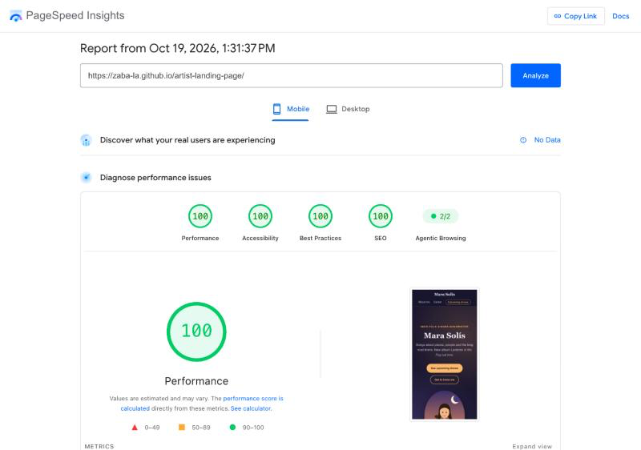
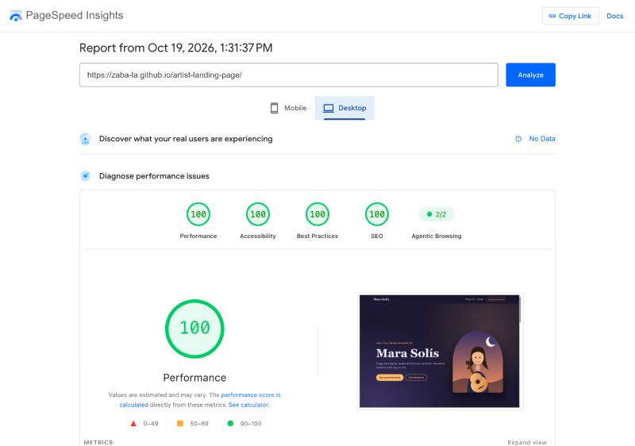

# Mara Solís — Artist Landing Page

Single-page site for an artist, built with **HTML and CSS only** (no JavaScript, no frameworks, no templates).

## Files

```
index.html          # content, semantic structure, Schema.org JSON-LD
styles.css          # all styles (Flexbox layout, BEM naming)
images/portrait.svg # hero illustration
images/favicon.svg
pagespeed-result.png  # add after running PageSpeed Insights
```

## Structure

`header > nav` → `main` (`#home` hero, `#about`, `#career`, `#shows`) → `footer`.
Each section is at least one viewport tall (`min-height: 100svh`).

## Checklist

- **Semantic HTML:** `header`, `nav`, `main`, `section`, `article`, `aside`, `footer`, `address`, `time`, `dl`.
- **Accessibility:** skip link, `aria-label` on both navs and ticket buttons, `aria-labelledby` on sections, `alt` on the image, one `h1` then `h2`/`h3`, visible `:focus-visible` outline, `prefers-reduced-motion` support.
- **SEO:** title, meta description, canonical, Open Graph tags, and JSON-LD with `Person`/`MusicGroup`, `MusicAlbum` and `MusicEvent`.
- **Performance:** no JS, system fonts (no web-font download), tiny SVG images with fixed `width`/`height`.

## Live site

**https://zaba-la.github.io/artist-landing-page/** (GitHub Pages, `main` branch)

## Results

| Check | Result |
| --- | --- |
| PageSpeed Insights — mobile | Performance 100 · Accessibility 100 · Best Practices 100 · SEO 100 |
| PageSpeed Insights — desktop | Performance 100 · Accessibility 100 · Best Practices 100 · SEO 100 |
| W3C HTML validator | 0 errors, 0 warnings |
| W3C CSS validator | 0 errors, 0 warnings |
| Schema.org validator | 0 errors, 0 warnings |

Full report: https://pagespeed.web.dev/analysis/https-zaba-la-github-io-artist-landing-page/a03i3vhcjr




